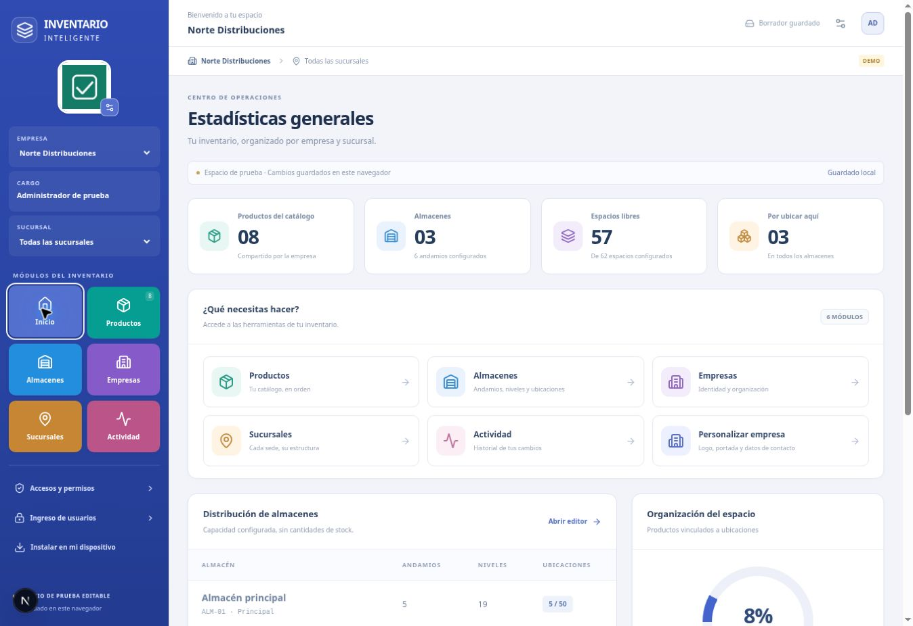

# 📦 Inventario Inteligente

**Tus empresas, productos y almacenes, organizados en un solo lugar.**

Una aplicación web para construir tu catálogo, personalizar cada empresa y diseñar la distribución de tus almacenes. Pensada para trabajar desde computadora, tableta o celular, con una interfaz clara y adaptable hecha con Tailwind CSS.

## 🚀 Prueba la aplicación

### [Abrir Inventario Inteligente en Vercel →](https://inventario-inteligente-snowy.vercel.app/)

[Ver y probar la interfaz móvil →](https://inventario-inteligente-snowy.vercel.app/vista-movil)

Puedes explorar los editores sin crear una cuenta. La aplicación inicia con **datos de ejemplo** para que pruebes las herramientas.

> **Estado: en desarrollo.** Los cambios e imágenes del espacio de prueba se guardan como borradores en el mismo navegador. Todavía no se comparten entre usuarios o dispositivos. El acceso real requiere conectar PostgreSQL y configurar la autenticación.



*Vista del editor con datos ficticios utilizados durante las pruebas.*

## Qué puedes hacer

| Módulo | Herramientas disponibles en el espacio de prueba |
| --- | --- |
| **Empresas** | Crear y editar datos, añadir logo y portada, elegir un color y consultar sus almacenes y productos. |
| **Productos** | Crear y editar fichas con imagen, código, categoría, marca, unidad y presentación. Buscar, filtrar y cambiar entre tabla y tarjetas. |
| **Archivo de productos** | Retirar productos del catálogo activo y restaurarlos después, conservando sus ubicaciones. |
| **Sucursales** | Crear y editar sedes; filtrar sus almacenes sin mezclar empresas. |
| **Almacenes** | Crear, configurar y eliminar almacenes con confirmación. Diseñar su distribución en un plano visual. |
| **Andamios y niveles** | Añadir, mover, duplicar y configurar andamios, niveles y espacios. |
| **Ubicaciones** | Asociar productos a un nivel y espacio, evitando posiciones ocupadas y cruces entre empresas. |
| **Actividad** | Consultar los cambios del borrador y descargar una copia de sus datos en JSON. |
| **Permisos** | Explorar y filtrar ejemplos de acceso por persona, empresa y almacén dentro del mismo diseño en el [laboratorio de permisos](https://inventario-inteligente-snowy.vercel.app/permisos). |

La navegación, permisos, acceso, recuperación y pantallas de carga comparten la identidad visual actual. La antigua demo independiente fue retirada; `/permisos` abre el módulo integrado.

Los formularios advierten si intentas cerrar con cambios sin guardar. Los editores comprueban códigos duplicados, posiciones ocupadas y reducciones de niveles que dejarían productos sin una ubicación válida.

## En qué estamos trabajando

La prioridad es conectar los editores al servidor para que los datos e imágenes puedan compartirse entre cuentas y dispositivos.

Después continuaremos con:

- Administración completa de usuarios, roles, invitaciones y revocación de sesiones.
- Inventarios operativos, asignaciones, conteos, revisión y aprobación.
- Reportes, comparaciones, exportaciones e historial del servidor.
- Fotografías de evidencia y trabajo sin conexión con sincronización y gestión de conflictos.

Las ubicaciones actuales organizan productos; **no registran conteos ni modifican existencias**. El historial del borrador tampoco sustituye una auditoría autenticada del servidor.

## En computadora y en Android

La interfaz de escritorio muestra empresa, cargo y sucursal junto a los módulos. En móvil tiene navegación inferior, catálogo en tarjetas y formularios adaptados. Puedes usar **Instalar en mi dispositivo** para ver las opciones de instalación web.

El manifiesto, los iconos y la apertura independiente están preparados. **No se ha generado un APK compilado ni firmado.** El inicio requiere conexión; el conteo y la sincronización offline siguen pendientes.

Consulta la [guía de diseño móvil y preparación Android](docs/mobile-and-android.md).

## Tecnologías

| Capa | Tecnología |
| --- | --- |
| Interfaz | Next.js 16.4.3, React 19.3 y Tailwind CSS 4 |
| Lenguaje | TypeScript |
| Autenticación preparada | Better Auth 1.7 |
| Persistencia del servidor prevista | PostgreSQL, con migraciones incluidas |
| Borradores del espacio de prueba | IndexedDB del navegador |
| Despliegue | Vercel |

La base del servidor incluye sesiones, registro público desactivado, límite de intentos en PostgreSQL y una API protegida para consultar y crear empresas. Las reglas de acceso validan organización, empresa, almacén y ámbito; una denegación explícita prevalece sobre una concesión.

## Ejecutar el proyecto

Necesitas **Node.js 22 o 24** y npm.

```bash
npm ci
npm run dev
```

Abre [localhost:3000](http://localhost:3000). La demo y la compilación funcionan sin configurar secretos ni conectarse a una base de datos.

### Comprobar el código

```bash
npm test
npm run typecheck
npm run build
```

Se incluyen **29 pruebas automatizadas** de permisos y validaciones del catálogo, plano y ubicaciones. Los escenarios A–E verifican reglas de autorización; la integración completa con sesiones, API y PostgreSQL requiere pruebas adicionales.

<details>
<summary><strong>Configurar el acceso real y PostgreSQL</strong></summary>

1. Crea una base PostgreSQL **de desarrollo**, local o alojada, y copia `.env.example` a `.env.local`.
2. Configura `DATABASE_URL`, un secreto aleatorio de al menos 32 caracteres en `BETTER_AUTH_SECRET` y el origen exacto en `BETTER_AUTH_URL`.
3. Ejecuta `npm run db:migrate`.
4. En un terminal confiable, define temporalmente `BOOTSTRAP_EMAIL`, `BOOTSTRAP_NAME`, `BOOTSTRAP_PASSWORD` (mínimo 12 caracteres) y `BOOTSTRAP_ORGANIZATION`. Ejecuta `npm run db:bootstrap` y retira esas variables. El script no imprime la contraseña. No subas estas variables al repositorio ni las guardes en Vercel.
5. Abre `/login`, inicia sesión y crea la primera empresa en `/workspace`.
6. Para recuperar el acceso por correo, configura Resend y un remitente verificado. Este servicio es opcional para la demo y requiere su propia configuración.

La cuenta propietaria inicial recibe permisos dentro de su organización; no tiene acceso a organizaciones ajenas. La administración completa y la delegación de permisos siguen en desarrollo.

</details>

<details>
<summary><strong>Desplegar en Vercel</strong></summary>

**Aplicación publicada:** https://inventario-inteligente-snowy.vercel.app/

Importa `sevenxfake-cmyk/InventarioInteligente` con esta configuración:

| Ajuste | Valor |
| --- | --- |
| Framework | Next.js |
| Directorio raíz | Raíz del repositorio |
| Instalación | `npm ci` |
| Compilación | `npm run build` |
| Node.js | 24 |
| Carpeta de salida | Predeterminada del framework |

La demo funciona sin variables de entorno. Para el acceso real, configura las variables del entorno correspondiente y ejecuta las migraciones explícitamente desde un terminal confiable, fuera del proceso de compilación.

Usa una base de desarrollo separada para las previews y un origen de autenticación estable. Las previews no deben conectarse por defecto a la base de producción. La base de datos y las fotografías operativas no se guardan en el disco del despliegue.

</details>

## Documentación

- [Editores: funciones, guardado y límites](docs/editors.md)
- [Arquitectura y reglas de permisos](docs/architecture.md)
- [Flujos de trabajo y criterios de aceptación](docs/workflows.md)
- [Operación, costos, respaldo y migración](docs/operations.md)

Este repositorio es independiente del proyecto anterior. El espacio de prueba permite revisar el diseño y los recorridos mientras se completa la integración necesaria para el uso operativo.
