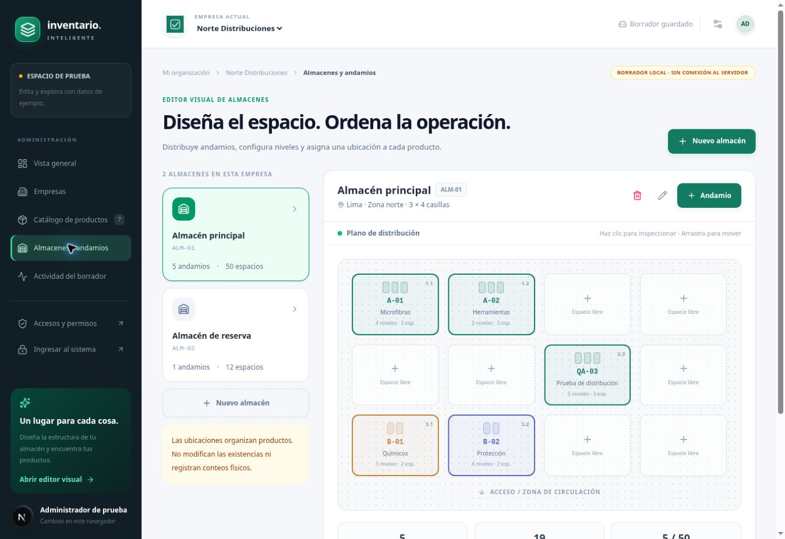
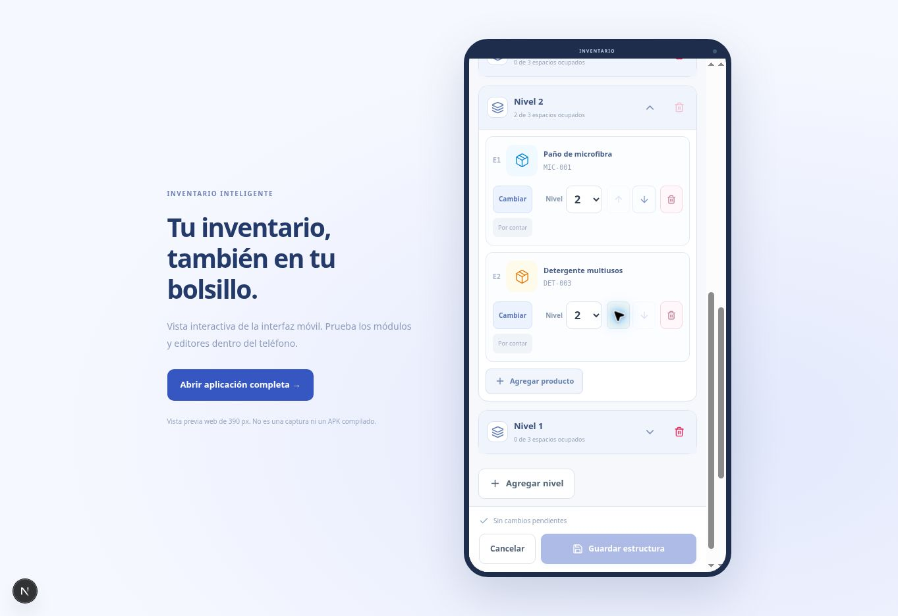

# Editores y rediseño de la segunda versión

## Disponible en el espacio de prueba

- Empresas: crear/editar nombre, RUC opcional, razón social, rubro, dirección, contactos y notas. Logo, portada y color configurables. Tarjetas con número de almacenes y productos.
- Productos: crear y editar fichas, código único por empresa sin distinguir mayúsculas, fotografía, categoría, marca, código de barras opcional, unidad y presentación. Búsqueda y filtros; tabla o tarjetas; paginación. Eliminar del catálogo activo significa archivar; se puede restaurar y se conservan sus ubicaciones.
- Almacenes: crear, editar y eliminar con confirmación, estructura independiente por empresa, nombre, código, dirección y responsable de referencia. Plano lógico de 2–8 filas y columnas, sin pretender medidas físicas.
- Andamios: añadir en una casilla, editar código/nombre/color, 1–12 niveles y 1–8 espacios por nivel; duplicar estructura sin duplicar ubicaciones; mover por arrastre o botón Mover + casilla destino. Eliminar exige confirmación y retira ubicaciones sin borrar productos.
- Ubicaciones: asociar un producto activo de la misma empresa con un nivel/espacio. No se pueden ocupar dos veces. Un producto puede tener varias ubicaciones. Reducir niveles/espacios ocupados se rechaza y pide reubicar primero.
- Panel con totales calculados a partir del borrador, guía de configuración, historial local de cambios y descarga JSON del borrador.
- Formularios con advertencia al cerrar con cambios sin guardar, errores de validación y confirmación únicamente después de guardar.

## Persistencia y límites

Este es un **editor de borradores de prueba**, no un inventario operativo conectado. IndexedDB guarda exclusivamente el espacio de prueba, con nombre y versión independientes. No se usa localStorage para datos ni permisos. Los cambios se conservan en el mismo navegador/origen; no se sincronizan con cuentas, otros dispositivos ni dominios de preview. Borrar los datos del navegador elimina ese borrador.

Las imágenes JPG/PNG/WebP de hasta 5 MB se decodifican y reducen a 1200 px como máximo para el borrador. No se envían al servidor. No se aceptan SVG ni archivos arbitrarios. El editor permite retirar y reemplazar imágenes. Al conectar producción, las imágenes deberán migrarse a almacenamiento privado de objetos y PostgreSQL guardará referencias, nunca data URLs de fotografías operativas.

El guardado comprueba una revisión dentro de una transacción IndexedDB: otra pestaña con una versión antigua recibe un conflicto y debe recargar, en vez de sobrescribir cambios. La cuota o bloqueo de almacenamiento produce un error y no una confirmación de guardado. El historial mostrado es local y no equivale a una auditoría de servidor autenticada.

Las ubicaciones no contienen cantidades: mover o asignar productos no actualiza stock ni registra conteos. Los permisos de acceso real no provienen del borrador. La autenticación y las APIs de la primera versión mantienen su separación.

## Verificación realizada

- 29 pruebas automatizadas: motor de permisos A–E y validaciones del catálogo, plano y ubicaciones.
- TypeScript y compilación Next.js.
- Navegador: crear producto, recargar y encontrarlo; archivar y restaurar; crear andamio de cinco niveles, moverlo y asignar un producto; cargar logo, guardar y comprobar que se conserva al recargar.
- No se ha probado en un celular físico ni con base PostgreSQL de producción. El modo offline operativo de trabajadores sigue pendiente.

## Próxima integración

Conectar los editores a casos de uso del servidor con permisos `products.create/edit/archive`, `warehouses.manage` y `placements.manage`, ámbitos por empresa y almacén, control de versiones y auditoría transaccional. Las fotografías requieren un proveedor de objetos. La edición colaborativa real no debe activarse usando el borrador del navegador como base principal.

## Vista del editor

La captura incluye los datos ficticios utilizados en las pruebas del navegador.

## Actualización v0.3

Se incorporan sucursales, navegación por módulos y adaptación móvil. Los borradores v2 se migran al modelo v3 sin borrar imágenes, productos ni ubicaciones: se crea una sucursal Principal por empresa y se vinculan los almacenes anteriores. La revisión se conserva para seguir detectando ediciones concurrentes. Los datos continúan siendo locales y no representan autorización del servidor. Ver [diseño móvil y Android](mobile-and-android.md).

## Editor de contenido por niveles

Selecciona un andamio en Almacenes y pulsa **Editar contenido**. El editor ancho se adapta a pantalla móvil y permite:

- Desplegar o contraer cada nivel; buscar productos activos por nombre, SKU o código de barras y elegir un resultado con su imagen.
- Cambiar el producto de una ubicación, moverlo a un nivel con espacio libre y reordenarlo con flechas. Se conservan los identificadores de las ubicaciones al moverlas.
- Agregar hasta 12 niveles y configurar hasta 8 espacios por nivel. Solo se eliminan niveles vacíos; los superiores se renumeran sin perder asignaciones.
- Quitar una ubicación conservando la ficha del producto. Los productos archivados ya ubicados siguen visibles y se pueden reubicar, pero no se añaden como nuevas asignaciones.
- Preparar varios cambios y aplicar **Guardar estructura** en una sola transacción IndexedDB con detección de conflictos. Cerrar o cancelar con cambios muestra la opción de seguir editando o descartar; recargar la pestaña también avisa.

El distintivo **Por contar** describe un conteo físico pendiente; no representa una cantidad calculada ni un módulo de conteo implementado. Se conservan el modelo v3 y los borradores anteriores.

Validación del editor por niveles: búsqueda por SKU, selección, cambio de producto, reordenamiento, cambio de nivel, guardado y recarga, eliminación de ubicación sin cambiar el catálogo, eliminación de nivel vacío, aviso de cambios pendientes y descarte. También se verificó búsqueda y orden en la vista de 390 px, sin desbordamiento horizontal del diálogo. Son pruebas en navegador; no equivalen a pruebas en un teléfono físico.

