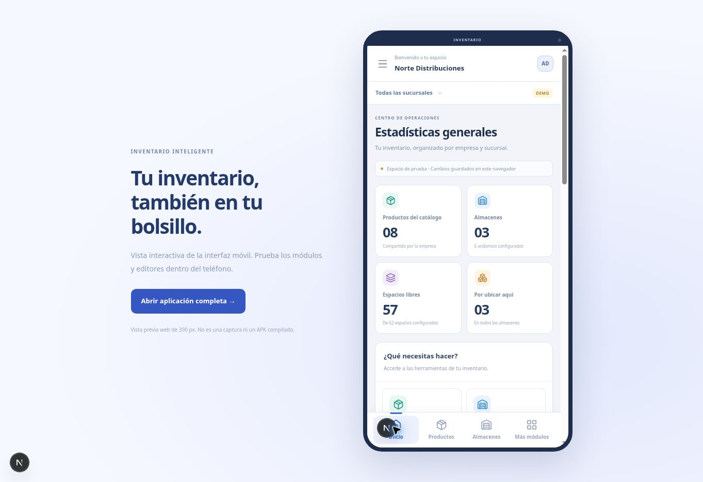
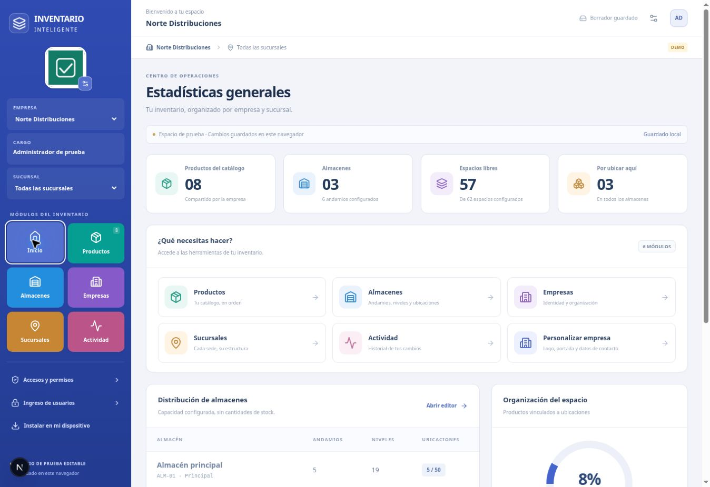

# Diseño ERP, interfaz móvil y preparación Android

## Referencia visual

Se aprovechó la organización de la captura aportada por el usuario: identidad de empresa visible, cargo, selector de sucursal, módulos con colores y resumen operativo. La identidad visual es de Inventario Inteligente y los módulos corresponden a funciones del inventario ya implementadas. La referencia no se usa como documentación de reglas de otro ERP.

## Cambios disponibles

- Escritorio: barra lateral azul, logo editable y contexto empresa/cargo/sucursal; accesos por módulos y resumen calculado de almacenes, andamios, niveles y espacios.
- Android/móvil: navegación inferior Inicio, Productos, Almacenes y Más módulos; menú completo con contexto; catálogo en tarjetas por defecto, formularios con campos de 48 px, pie de acciones y espacio para áreas seguras del dispositivo.
- Sucursales: crear/editar, asignar almacenes y filtrar por sede. El catálogo sigue siendo de empresa. Las estadísticas de almacenes y ubicaciones se filtran por sucursal; los productos del catálogo están identificados como compartidos por empresa.
- Navegación mediante fragmentos de URL para permitir volver entre pantallas y abrir accesos directos a Productos y Almacenes.
- Vista interactiva de 390 px en `/vista-movil`; es la aplicación real dentro de un marco de teléfono, no una imagen. Se usa también para revisar las media queries desde un navegador de escritorio.

## Borradores existentes

Modelo v3 con sucursales. `upgradeDraft` transforma los borradores v2 al leer, preservando imágenes, ids, productos, ubicaciones y revisión. Cada empresa anterior recibe una sucursal Principal. No se crea otra base IndexedDB ni se reinician los datos. La migración no se confunde con una sincronización de servidor: PostgreSQL continúa pendiente de configuración.

## Instalación web en Android

`app/manifest.ts` declara nombre, idioma, iconos 192/512, icono adaptable, color de tema y modo `standalone`, además de accesos directos a Productos y Almacenes. `app/layout.tsx` prepara el viewport y las áreas seguras; incluye icono para iOS.

En un navegador compatible, el botón Instalar aprovecha `beforeinstallprompt` cuando está disponible. Si no está disponible, muestra instrucciones; no promete que todos los navegadores presenten la misma opción. Desde Chrome en Android se puede usar el menú de instalación o añadir a inicio según las opciones ofrecidas por esa versión del navegador.

El service worker solo almacena iconos y una página pública de aviso sin conexión. No almacena respuestas de API, sesiones ni páginas de datos. La navegación usa primero la red y muestra el aviso si falla. **Abrir la aplicación sigue requiriendo conexión**; no se afirma que ya exista conteo operativo offline ni sincronización en segundo plano.

Referencias oficiales consultadas:
- https://nextjs.org/docs/app/api-reference/file-conventions/metadata/manifest
- https://nextjs.org/docs/app/guides/progressive-web-apps
- https://web.dev/learn/pwa/installation

## Preparación para un APK descargable

Este avance entrega la interfaz web adaptable y la preparación de instalación PWA. **No contiene un APK compilado o firmado.**

Para empaquetar posteriormente la misma web, una opción documentada por Android es una Trusted Web Activity, generada con Bubblewrap. La compilación requiere un entorno Android/JDK, elegir el identificador de paquete y administrar una clave de firma. El vínculo con el dominio se demuestra mediante Digital Asset Links y el certificado SHA-256 real. No se publica un archivo `assetlinks.json` con identificadores o huellas inventados.

Antes de distribuir un APK: confirmar dominio estable e identificador de paquete; configurar la firma fuera del repositorio; comprobar el flujo de login y selección de imágenes en un dispositivo real; conectar PostgreSQL y el almacenamiento operativo de imágenes; verificar actualizaciones y recuperación de acceso. Las claves y contraseñas de firma no se guardan en GitHub.

Referencia oficial: https://developer.android.com/develop/ui/views/layout/webapps/guide-trusted-web-activities-version2

## Verificación realizada y límites

- 22 pruebas automatizadas: permisos, catálogo/plano/ubicaciones, migración v2→v3 y ámbito de sucursales.
- Navegador de escritorio y marco móvil de 390 px: navegación inferior, catálogo en tarjetas, creación de producto desde el formulario móvil, creación de sucursal, almacén vinculado y filtro de almacenes por sucursal.
- Menú Más módulos e instrucciones de instalación comprobados en navegador.
- TypeScript y compilación Next.js.
- No se ha instalado la PWA ni un APK en un teléfono físico. La prueba del marco móvil no equivale a prueba de teclado, cámara, selector nativo de fotos o gestos de Android.

## Capturas de la revisión

Las capturas contienen los datos ficticios usados para probar las operaciones.

